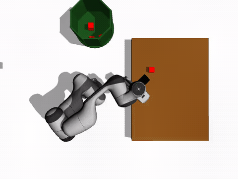
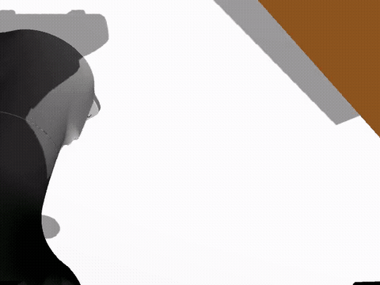

# Franka Panda Autonomous Manipulation & LeRobot ACT Policy


An end-to-end robotic manipulation framework combining **Imitation Learning (LeRobot ACT Policy)**, classical motion planning (**MoveIt 2**), and computer vision (**OpenCV + TF Ray Casting**) using the 7-DOF **Franka Emika Panda** manipulator in **Ignition Gazebo**.

<p align="center">
  
</p>
<p align="center">
  <em>Synchronized Demonstration Playback: Overhead Camera View (Left) &amp; Eye-in-Hand Gripper Camera View (Right)</em>
</p>

---

## 📋 Table of Contents
1. [Project Overview](#-project-overview)
2. [Repository Structure](#-repository-structure)
3. [Verified Training Parameters](#-verified-training-parameters)
4. [Prerequisites & Installation](#-prerequisites--installation)
5. [Quick Start: LeRobot Policy Run](#-quick-start-lerobot-policy-run)
6. [Classical Manipulation Modes](#-classical-manipulation-modes)
7. [Git & GitHub Setup Guide](#-git--github-setup-guide)
8. [License](#-license)

---

## 🚀 Project Overview

This repository demonstrates two distinct paradigms for autonomous robotic manipulation:

1. **Learning from Demonstration (LfD) with LeRobot**:
   - Executes an **Action Chunking with Transformers (ACT)** policy trained on demonstration trajectories.
   - Subscribes to dual camera feeds (Overhead Camera and Hand/Wrist Camera) plus joint states.
   - Incorporates a physical **Gripper Threshold Filter** to ensure firm grasping and reliable release into the bin.
2. **Autonomous Classical Perception & Planning**:
   - **Table Cleaning Mode**: 2D HSV segmentation and 3D TF ray-plane projection coupled with Cartesian MoveIt 2 trajectories.
   - **Color Sorting Mode**: High-priority color-based sorting (**Red** $\rightarrow$ **Blue** $\rightarrow$ **Green**) with dedicated target bins.

---

## 📂 Repository Structure

```text
lerobot_single_pose_working/
├── .gitattributes                     # Git LFS configuration for safetensors/models/videos
├── .gitignore                        # Standard ROS 2 and Python ignore rules
├── demo.md                           # Step-by-step LeRobot demo walkthrough
├── policy_run_gripper_threshold.py   # Main LeRobot ACT inference and execution script
├── checkpoints_single_pose/          # Pretrained ACT policy checkpoints (10k, 20k steps)
│   └── 020000/pretrained_model/      # Active model weights (model.safetensors, config.json)
├── lerobot_10 single_position/       # Single-pose dataset (chunked parquet, videos, stats.json)
└── src/
    ├── automatic_pnp/                # MoveIt 2 Cartesian trajectory pick-and-place & sorting
    ├── cube_spawner/                 # Gazebo object spawner & system bringup launch files
    ├── franka_moveit_config/         # MoveIt 2 config, controllers, worlds, and dual cameras
    ├── panda_description/            # URDF kinematic model and 3D visual/collision meshes
    └── tf_detector/                  # OpenCV color segmentation & 3D TF ray-casting
```

---

## 📌 Verified Training Parameters

The LeRobot model in `checkpoints_single_pose/020000` was trained on a single, fixed cube pose:

| Parameter | Value | Details |
|---|---|---|
| **Cube Position** | **`X = 0.45, Y = 0.15, Z = 0.121`** | Middle of table, center-left |
| **Cube Color & Size** | **Red**, $0.04 \times 0.04 \times 0.04\text{ m}$ | Uniform density ($m = 0.01\text{ kg}$) |
| **Table Surface** | $Z = 0.10\text{ m}$ | Box center at $Z = 0.05\text{ m}$, height $0.10\text{ m}$ |
| **Bin Location** | $X = 0.0\text{ m}, Y = 0.5\text{ m}, Z = 0.5\text{ m}$ | Target drop location |
| **Observation Inputs** | Dual RGB ($640 \times 480$) + 9-DOF State | Overhead camera, wrist camera, joints |

---

## 📹 Dataset & Demonstration Videos (`lerobot_10 single_position`)

The dataset contains **11 demonstration episodes (3,948 frames at 30 FPS)** recorded in Hugging Face LeRobot format v3.0. Each episode captures full trajectory pick-and-place execution from two simultaneous camera streams:

<p align="center">
  
  
</p>
<p align="center">
  <em>Left: Overhead Camera (Global workspace) &bull; Right: Wrist Camera (Eye-in-hand alignment &amp; grasp)</em>
</p>

- **Raw Video Files**:
  - `lerobot_10 single_position/lerobot_dataset_v3_final/videos/observation.images.world/chunk-000/file-000.mp4`
  - `lerobot_10 single_position/lerobot_dataset_v3_final/videos/observation.images.gripper/chunk-000/file-000.mp4`
- **State & Action Data**: `chunk-000/file-000.parquet`
- **Normalization Stats**: `meta/stats.json`

---

## 🛠 Prerequisites & Installation

### System Requirements
- **OS**: Ubuntu 22.04 LTS
- **ROS 2**: Humble Hawksbill
- **Simulation**: Ignition Gazebo Fortress (`ros_ign_gazebo`, `ros_gz_bridge`)
- **Python**: Python 3.10

### 1. Build ROS 2 Packages
```bash
cd ~/Desktop/completed/lerobot_single_pose_working
source /opt/ros/humble/setup.bash
colcon build --symlink-install
source install/setup.bash
```

### 2. Python Dependencies for LeRobot Inference
```bash
python3 -m pip install torch torchvision --index-url https://download.pytorch.org/whl/cpu
python3 -m pip install "diffusers<0.30" datasets accelerate deepdiff av draccus safetensors
```

---

## 🎬 Quick Start: LeRobot Policy Run

Follow these three terminal steps to run the autonomous LeRobot pilot:

### Terminal 1: Launch Simulation & Controllers
```bash
cd ~/Desktop/completed/lerobot_single_pose_working
source /opt/ros/humble/setup.bash
source install/setup.bash
ros2 launch cube_spawner bringup.launch.py
```
*Wait ~10 seconds until Gazebo opens and the controllers (`panda_arm_controller`, `hand_controller`) finish initializing.*

### Terminal 2: Spawn Cube at Trained Position
```bash
ros2 run ros_gz_sim create \
  -string "<?xml version='1.0'?><sdf version='1.6'><model name='red_block_target'><pose>0 0 0 0 0 0</pose><link name='link'><inertial><mass>0.01</mass><inertia><ixx>0.0001</ixx><ixy>0</ixy><ixz>0</ixz><iyy>0.0001</iyy><iyz>0</iyz><izz>0.0001</izz></inertia></inertial><collision name='collision'><geometry><box><size>0.04 0.04 0.04</size></box></geometry><surface><friction><ode><mu>1.0</mu><mu2>1.0</mu2></ode></friction></surface></collision><visual name='visual'><geometry><box><size>0.04 0.04 0.04</size></box></geometry><material><ambient>1 0 0 1</ambient><diffuse>1 0 0 1</diffuse></material></visual></link></model></sdf>" \
  -name red_block_target \
  -allow_renaming true \
  -x 0.45 -y 0.15 -z 0.121
```

### Terminal 3: Run Policy Inference
```bash
cd ~/Desktop/completed/lerobot_single_pose_working
source /opt/ros/humble/setup.bash
python3 policy_run_gripper_threshold.py
```
The robot will autonomously approach the cube, clamp it with the thresholded gripper, lift it, and drop it into the dustbin.

---

## 🔄 Classical Manipulation Modes

### Mode A: Continuous Table Cleaning
```bash
# Terminal 1
ros2 launch tf_detector vision_system.launch.py

# Terminal 2
ros2 run automatic_pnp clear_table
```

### Mode B: Priority Color Sorting
```bash
# Terminal 1
ros2 launch tf_detector sorting_system.launch.py

# Terminal 2
ros2 run automatic_pnp automated_sorting
```

---

## 📤 Git & GitHub Setup Guide

To push this repository to GitHub cleanly:

### 1. Initialize Git LFS
Since model weights (`*.safetensors`, `*.mp4`) are large, Git LFS must be initialized:
```bash
cd ~/Desktop/completed/lerobot_single_pose_working
git lfs install
```

### 2. Initialize Git Repository & Commit
```bash
git init
git add .
git commit -m "feat: complete Franka Panda LeRobot ACT policy and autonomous manipulation suite"
```

### 3. Push to GitHub
```bash
# Replace with your GitHub repository URL
git remote add origin https://github.com/<your-username>/<your-repo-name>.git
git branch -M main
git push -u origin main
```

---

## 📄 License

- Robot kinematics & mesh models: Apache 2.0 (Franka Emika / MoveIt).
- Core manipulation framework and policies: MIT License.

