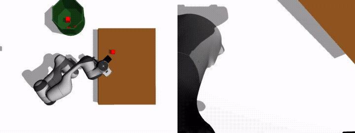

# Franka Panda LeRobot ACT Policy Demo Guide

This guide walks through launching the Gazebo simulation environment, spawning the cube at the **exact single position where LeRobot was trained**, and executing the policy script `policy_run_gripper_threshold.py`.

<p align="center">
  
</p>
<p align="center">
  <em>Ground-Truth Demonstration: Overhead Camera (Left) &amp; Wrist Camera (Right)</em>
</p>

---

## 📌 Verified Cube Training Position

From analyzing the dataset (`lerobot_10 single_position`), forward kinematics of recorded grasp trajectories, and `src/cube_spawner/cube_spawner/timely_spawner.py`:

| Coordinate | Value | Description |
|---|---|---|
| **X** | **`0.45`** | Distance forward in front of robot base |
| **Y** | **`0.15`** | Distance to the left of robot base (center-left) |
| **Z** | **`0.121`** | Drop height on the table (table surface is at $Z = 0.10\text{ m}$) |
| **Color** | **Red** | Dimensions: $0.04 \times 0.04 \times 0.04\text{ m}$ ($4\text{ cm}$ cube) |

---

## 🚀 Step-by-Step Execution

### Terminal 1: Build Workspace & Launch Environment

Launch Ignition Gazebo, the Franka Emika Panda robot with dual cameras, and MoveIt 2:

```bash
cd /home/roboholic_harsh/Desktop/completed/lerobot_single_pose_working
source /opt/ros/humble/setup.bash
colcon build --packages-select cube_spawner franka_moveit_config panda_description tf_detector automatic_pnp
source install/setup.bash
ros2 launch cube_spawner bringup.launch.py
```

> **Wait ~10 seconds** until:
> - Gazebo opens with the table and Panda robot.
> - The joint state broadcaster and controllers (`panda_arm_controller`, `hand_controller`) are loaded.
> - The dual camera bridges (`/camera/overhead_camera/image_raw` and `/camera/hand_camera/image_raw`) are active.

---

### Terminal 2: Spawn the Cube at the Trained Position

Open a new terminal to spawn the red cube at $(X=0.45, Y=0.15, Z=0.121)$:

```bash
cd /home/roboholic_harsh/Desktop/completed/lerobot_single_pose_working
source /opt/ros/humble/setup.bash
source install/setup.bash
ros2 run cube_spawner spawn_block
```

---

### Terminal 3: Run the LeRobot ACT Policy

Run the trained ACT policy with gripper thresholding to execute the autonomous pick-and-place task:

```bash
cd /home/roboholic_harsh/Desktop/completed/lerobot_single_pose_working
source /opt/ros/humble/setup.bash
python3 policy_run_gripper_threshold.py
```

### What to Expect:
1. The script loads dataset statistics from:
   `lerobot_10 single_position/lerobot_dataset_v3_final/meta/stats.json`
2. It hydrates and loads the trained ACT policy model weights from:
   `checkpoints_single_pose/020000/pretrained_model`
3. Subscribes to:
   - `/camera/overhead_camera/image_raw`
   - `/camera/hand_camera/image_raw`
   - `/joint_states`
4. The policy runs inference at 10 Hz:
   - Moves the 7-DOF arm toward the cube at `(X=0.45, Y=0.15)`
   - Descends and closes the gripper when the predicted physical opening drops below `0.032 m` (applying threshold clamping to `0.00 m` for a secure grip)
   - Lifts the cube, transports it to the dustbin at `(X=0.0, Y=0.5, Z=0.5)`, opens the gripper (`0.04 m`), and drops the cube into the bin.

---

## 🔧 Technical Details & Troubleshooting

- **Checkpoints Used:** `checkpoints_single_pose/020000/pretrained_model` (20,000 steps ACT model).
- **Dataset Stats:** `lerobot_10 single_position/lerobot_dataset_v3_final/meta/stats.json`.
- **Gripper Threshold Logic:**
  - If predicted gripper width $> 0.032\text{ m}$ $\rightarrow$ Full Open ($0.04\text{ m}$).
  - Else $\rightarrow$ Closed ($0.00\text{ m}$).
- **Joint Order:** Automatically handled by `scrambled_joint_names` inside `policy_run_gripper_threshold.py` to match the order recorded during demonstration training.

